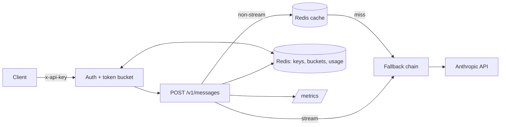

# llm-gateway

Production-style LLM gateway for the Anthropic Messages API: API keys, Redis rate limiting and caching, model fallback, cost tracking and Prometheus metrics.

[](https://github.com/Muhaman/llm-gateway/actions/workflows/ci.yml)

## What it does

- **Transparent proxy** for `POST /v1/messages` (JSON and SSE streaming). The gateway holds the one real Anthropic key; clients get revocable `gw_...` keys.
- **Per-key limits**: a Redis token bucket for requests per minute and a daily token budget.
- **Response cache** for identical non-streaming requests, scoped per key.
- **Model fallback**: on 429 / 529 / 5xx / connection errors it walks `FALLBACK_MODELS`; client errors (4xx) are passed through untouched.
- **Cost and usage tracking** per key per UTC day, and Prometheus metrics at `/metrics`.

## Architecture



## Quickstart

```bash
cp .env.example .env              # set ANTHROPIC_API_KEY
docker compose up --build         # gateway on :3000, redis:7 on :6379
# Redis is bound to 127.0.0.1 on purpose so it is not exposed to the network.
npm install && npm run create-key -- demo 60 1000000   # prints the gw_ key once
```

## Usage

```bash
curl -s localhost:3000/v1/messages \
  -H "x-api-key: $GW_KEY" -H "content-type: application/json" \
  -d '{"model":"claude-opus-5-5","max_tokens":256,"messages":[{"role":"user","content":"Say hi"}]}' -i
# x-gateway-cache: MISS|HIT, x-gateway-model: <serving model>, x-request-id: ...

curl -s "localhost:3000/v1/usage?days=7" -H "x-api-key: $GW_KEY"
curl -s localhost:3000/metrics
```

Add `"stream": true` to receive `event: <type>` / `data: <json>` SSE events. Gateway-originated errors use `{ "error": { "code", "message" } }`; upstream 4xx bodies are returned unchanged.

| Env | Default | Notes |
|---|---|---|
| `ANTHROPIC_API_KEY`, `REDIS_URL` | required | startup fails naming the variable |
| `FALLBACK_MODELS` | `claude-opus-5-5,claude-sonnet-5-5` | the allowed models and the fallback order; a request for any other model gets 400 `model_not_allowed` |
| `CACHE_TTL_S` | `3600` | |
| `PORT` | `3000` | |

Metrics: `gateway_request_duration_seconds`, `gateway_tokens_total{direction,model}`, `gateway_cache_hits_total`, `gateway_upstream_errors_total{status}`.

## Design decisions & trade-offs

- **Atomic limiter**: the token bucket is one Lua script using Redis `TIME`, so concurrent gateway replicas share one clock and never over-admit.
- **Keys are hashed**: Redis stores `sha256(key)` only; the raw key is shown once at creation.
- **Cache is per key**, not global, so one tenant can never read another's completions. The cache key is the sha256 of canonical JSON (sorted keys) minus `stream` and `metadata`. Refusals are not cached.
- **Fallback decisions live in the gateway**: SDK retries are disabled and the Anthropic client sits behind an `Upstream` interface, so tests drive 529s, 400s and streams with a fake.
- **No server-side `fallbacks` injection**: the gateway never alters client bodies; its own chain covers overload. `FALLBACK_MODELS` is both the allowlist and the fallback order: the requested model is tried first, then the rest of the list. Any model outside it gets 400 `model_not_allowed` rather than being silently swapped for another.
- **Disconnects abort upstream**: closing the client socket aborts the upstream request through an `AbortSignal`.

## Testing

Tests need Redis (`REDIS_URL`, default `redis://localhost:6379`); each test file uses a unique key prefix and cleans only its own keys.

```bash
npm test
```

CI runs lint, typecheck and tests against a `redis:7` service.

## Limitations & next steps

- The daily token budget is checked before a request and charged after it, so a single request can overshoot.
- Cache-creation tokens are not priced; the haiku cache-read price is an assumption (10% of input).
- `anthropic-beta` and other client headers are not forwarded; `/metrics` is unauthenticated (restrict at the network layer).
- Streams that fail after the first byte cannot fall back; the client receives an SSE `error` event.

## License

MIT
